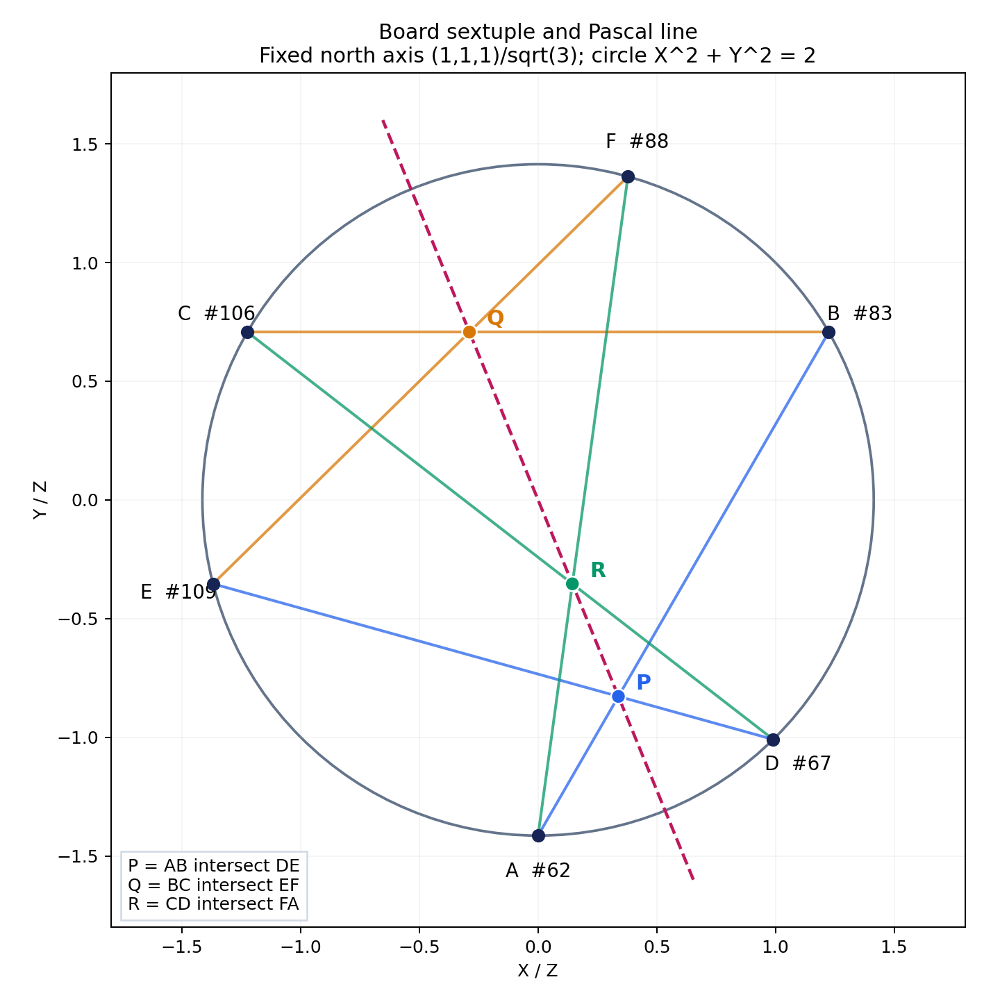

# 星航 Design Note：固定球心投影下的六点圆锥与 Pascal 结构

日期：2026-11-06

状态：几何探索记录；不是游戏规则决议，也不是完整分类。

## 摘要

在现有扭棱十二面体 302 点盘面上，固定“玄北”坐标轴、同一开半球与球心投影后，有界的等纬搜索发现了三组数值共非退化圆锥的六点候选。其中一组对应一个简洁的黄金比例理想模型：六点严格投影到圆 $u^2+v^2=2$，其 Pascal 三交点严格共线。

本记录必须区分三个层次：

| 层次 | 已建立的结论 |
|---|---|
| 精确理想坐标 | 已用符号计算验证非退化圆锥与 Pascal 共线 |
| 理想坐标与代码点 ID 的关系 | 已用现有 NPZ 双精度数据数值匹配，误差约 $10^{-16}$；不是生成器到全部 ID 的形式化证明 |
| 运行时 JSON 的字面坐标 | 只近似满足；主例的六点矩阵按精确有理数计算实际秩为 6，不能说它严格共圆锥 |



图中六个盘面点标作 A–F，三组同色弦分别产生 P、Q、R；虚线为 Pascal 直线。这里只绘制几何构造，没有赋予连线或辅助交点任何游戏作用。

## 1. 动机与探索问题

星航采用球面盘面，值得先确认盘面是否含有能被辨认、解释和复现的射影几何结构，再讨论这些结构是否有设计价值。本次问题是：

> 盘面上有哪些六个不同交叉点，在一个固定、明确的投影规则下共非退化圆锥曲线？

探索选择为：**球心投影，先研究一个开半球内的交叉点**。Pascal 定理提供进一步的可检验结果：六点共非退化圆锥时，按顺序构造的三对对边交点共线。

这不是“任取六点都成立”的命题，也不允许为每组六点另选坐标系、半球或投影。球面小圆上的六点是一个容易先找的充分来源，但并非所有共圆锥六点组都必须来自小圆。

## 2. 实际盘面与来源

探索阶段未重新生成或修改来源项目，使用的是 Games 源目录下的现有代码和数据。下表均为相对于该外部源目录的历史来源路径，不是本仓库内的链接；本仓库收录的静态数据快照及指纹见[追溯与复现](#9-追溯与复现)。

| 项目相对路径 | 来源角色 |
|---|---|
| `astrial/src/board.json` | Astrial 服务器实际嵌入的 302 点静态盘面 |
| `polyclash/polyclash/web/data/board.json` | PolyClash 前端静态盘面；与前者逐字节相同 |
| `polyclash/model3d/board.npz` | 同一盘面的双精度坐标、原多面体和细分拓扑 |
| `polyclash/scripts/gen_mesh.py` | 用 $\phi=(1+\sqrt5)/2$、方程 $\xi^3+2\xi^2-\phi^2=0$ 的正实根及旋转 $S,T$ 构造扭棱十二面体顶点，建立边与面 |
| `polyclash/scripts/reindex.py` | 固定顶点重编号，五边形各占连续的五个顶点 ID |
| `polyclash/scripts/gen_cities.py` | 依次取原顶点、边中点、三角面重心和五边形面重心 |
| `polyclash/scripts/gen_board.py` | 编制点 ID，建立“顶点—边中点—面中心”的四边形细分及邻接 |
| `polyclash/polyclash/data/data.py`、`polyclash/scripts/export_data.py` | 内嵌坐标、编码、地理轴及 JSON 导出 |
| `astrial/src/data.rs` | 记录“玄北”等地理方向，其中第 0 轴为 $(1,1,1)/\sqrt3$ |

两处来源并非因为同名而被视为相同：本次已核对 JSON 字节、NPZ 与 JSON 的面和细分拓扑，以及中心坐标的重算结果。它们确实对应同一份**扭棱十二面体及其 302 点细分**。这为星航探索提供了可复用的数据来源，但不代表已经为星航采纳了新的盘面实现或游戏规则。

原多面体有 60 顶点、150 边、80 三角面和 12 五边形面。细分后的交叉点定义如下：

| ID 范围，0 起算 | 点的含义 | 数量 |
|---|---|---:|
| 0–59 | 原顶点 | 60 |
| 60–209 | 原边中点 | 150 |
| 210–289 | 原三角面重心 | 80 |
| 290–301 | 原五边形面重心 | 12 |

细分得到 240 个小四边形和 60 个大四边形。“交叉点”只指数据中的 `cities`，不包括任意延长线产生的新交点。下文的 Pascal 交点是辅助几何点，不是新增落子点。

**稳定 ID 的适用范围**是本次指纹固定的数据行号；另用 `encoder` 原顶点元组标识点的来源。没有假定未来重新生成数据时枚举顺序必然不变。

### 坐标并非天然位于同一球面

生成代码保存的是多面体上的顶点及各类中心，没有将所有点径向归一化。四类点的半径约为 0.969589193、0.943151259、0.934172359 和 0.890918172。

实验先将原坐标 $p$ 化为球面方向 $s=p/\|p\|$。因为球心投影只取坐标比值，这个径向归一化**不会改变投影点**，但使“小圆”“等纬”等球面描述有明确含义。

## 3. 固定坐标系、开半球与投影

选用已有“玄北”方向，而不是根据某组六点临时调整。相对于源数据坐标，固定右手正交标架为

$$
e_X=\frac{(1,-1,0)}{\sqrt2},\qquad
e_Y=\frac{(1,1,-2)}{\sqrt6},\qquad
e_Z=\frac{(1,1,1)}{\sqrt3}.
$$

对球面点 $s$，定义

$$
(X,Y,Z)=(s\cdot e_X,s\cdot e_Y,s\cdot e_Z),\qquad
(u,v)=\left(\frac XZ,\frac YZ\right).
$$

全程只考虑同一开半球 $Z>0$，投影平面固定为 $Z=1$。

数值计算剔除 $|Z|\le10^{-8}$ 的近赤道带，避免除以接近零的深度。这是数值保护，不是将数学上的开半球改为闭半球。实际剔除 ID 为 **118、127、137、149、164、174**，保留正半球 148 点；最小保留 $Z$ 约为 0.01067088。主例所有点的理想高度均为 $1/\sqrt3$，不受近赤道问题影响。

## 4. 共圆锥与非退化判据

将六个投影点写为齐次坐标 $h_i=(X_i,Y_i,Z_i)$，构造矩阵

$$
M_{i,:}=(X_i^2,\ X_iY_i,\ Y_i^2,\ X_iZ_i,\ Y_iZ_i,\ Z_i^2).
$$

存在非零系数向量 $(a,b,c,d,e,f)^T$ 使 $M(a,b,c,d,e,f)^T=0$，即六点共一条二次曲线。其圆锥矩阵为

$$
Q_{\mathrm{conic}}=
\begin{pmatrix}
a&b/2&d/2\\
b/2&c&e/2\\
d/2&e/2&f
\end{pmatrix}.
$$

还须要求 $\det Q_{\mathrm{conic}}\ne0$，排除两条直线等退化情况；不能仅凭一个很小的六阶行列式判断“找到了圆锥”。

数值实验将齐次点和矩阵各行按二范数归一化后做 SVD，以 $\sigma_6/\sigma_1<10^{-8}$ 作为近共圆锥判据，同时检查 $\sigma_5/\sigma_1>10^{-6}$、拟合圆锥矩阵的最小/最大奇异值比 $>10^{-6}$，并对主例检查全部三点组不共线。**这些容差只表达数值近似，不等于符号证明。**

## 5. 找到的三组候选与主例

本次仅按固定 $e_Z$ 轴搜索等纬小圆：保留点按 $Z$ 排序，以整簇高度跨度不超过 $10^{-8}$ 聚类，再检查各簇中的六点组。47 个高度簇中只有三个簇达到六点，且每簇恰有六点：

| 六点 ID | NPZ 球面高度 $Z$，约值 | 结论地位 |
|---|---:|---|
| 217, 230, 240, 245, 247, 258 | 0.3333333333 | 数值非退化圆锥候选 |
| **62, 67, 83, 88, 106, 109** | **0.5773502692** | 数值候选，并有下面的精确理想模型 |
| 69, 70, 77, 90, 91, 101 | 0.9341723590 | 数值非退化圆锥候选 |

NPZ 和 JSON 都得到这三个簇。另两组没有在本次工作中完成对应的精确符号溯源，不应将主例的证明自动推广给它们。

### 主例的点 ID 与精确理想坐标

为得到清晰的 Pascal 构造，将主例按下表顺序标号。原始球面标架下，令 $\phi=(1+\sqrt5)/2$：

| 标号 | ID | `encoder`：原边端点 | 精确理想单位方向 $(x,y,z)$ |
|---|---:|---|---|
| A | 62 | (6,35) | $(0,0,1)$ |
| B | 83 | (1,18) | $(1,0,0)$ |
| C | 106 | (10,49) | $(0,1,0)$ |
| D | 67 | (3,36) | $(1/2,(1-\phi)/2,\phi/2)$ |
| E | 109 | (8,48) | $((1-\phi)/2,\phi/2,1/2)$ |
| F | 88 | (12,17) | $(\phi/2,1/2,(1-\phi)/2)$ |

NPZ 中这六个单位方向与表中理想坐标的最大逐坐标差为 $1.6654\times10^{-16}$。这是**代码点 ID 与理想模型的数值对应证据**，不是对生成代码全过程的精确代数证明。

对表中的精确坐标，由 $\phi^2=\phi+1$ 可以严格得到

$$
x^2+y^2+z^2=1,\qquad x+y+z=1.
$$

所以六点在同一球面小圆上，且 $Z=1/\sqrt3>0$。在固定投影中，

$$
u^2+v^2=\frac{1-Z^2}{Z^2}=2.
$$

对应齐次圆锥为 $U^2+V^2-2W^2=0$，其矩阵为 $\operatorname{diag}(1,1,-2)$，行列式为 $-2$，严格非退化。符号计算确认六点矩阵秩恰为 5，唯一确定这条圆锥。

**结构解释：**生成器中的 $S:(x,y,z)\mapsto(z,x,y)$ 将六点分为 A→B→C→A 和 D→F→E→D 两个三重旋转轨道。旋转保证各轨道内部等纬；两个轨道位于同一纬度，还依赖上面的黄金比例恒等式，不能只凭“三重对称”得出。

## 6. Pascal 构造与严格共线结论

采用主例的 A–F 顺序，令

$$
P=AB\cap DE,\qquad Q=BC\cap EF,\qquad R=CD\cap FA.
$$

每条直线和每个交点均用齐次叉积计算，例如

$$
P=(A\times B)\times(D\times E).
$$

这样的实现可以保留无穷远点，不会预先假定所有交点都能写成有限仿射坐标。主例已检查六条弦定义良好、三对交线不重合、三个交点互不相同，且本例三个交点均有限。

对上述**精确理想坐标**，符号计算验证 P、Q、R 均严格满足同一直线：

$$
\boxed{\frac{2\sqrt3+\sqrt{15}}3\,u+v=0.}
$$

三次代入残差均严格为零。这是本次 Pascal 共线的严格结论；图示用于解释构造，不代替证明。完整交点表达式保留在实验结果中，正文不重复展开。

## 7. 舍入限制与反例

下表保留足以判断证据量级的核心指标；完整数据见相邻的 [results.json](results.json)。

| 主例指标 | NPZ 双精度 | 运行时 JSON |
|---|---:|---:|
| 六点圆锥矩阵 $\sigma_6/\sigma_1$ | $6.18\times10^{-17}$ | $5.07\times10^{-10}$ |
| 拟合圆锥矩阵最小/最大奇异值比 | 0.500000 | 0.500000 |
| Pascal 三交点矩阵 $\sigma_3/\sigma_1$ | $9.25\times10^{-17}$ | $3.30\times10^{-10}$ |

NPZ 与 JSON 的最大逐坐标差约为 $4.987\times10^{-10}$，与上述差别相符。NPZ 本身仍是浮点数据，接近机器精度的残差也不能独立成为“严格成立”的证据。

**关键限制：把 JSON 的十进制字面坐标当作精确有理数，主例的六点矩阵秩实际为 6，行列式严格非零。** 可逆的固定坐标变换和逐点归一化不改变是否共圆锥，因此不能绕过这一事实。正确表述是“实际 JSON 高精度近似实现了理想模型”，而非“实际 JSON 六点严格共圆锥”。

同一开半球内的 ID **0、1、2、3、4、5** 提供反例：数值 $\sigma_6/\sigma_1$ 约为 0.0476659，远离共圆锥阈值，全部三点组也都不共线。JSON 字面坐标的精确有理数计算同样给出秩 6，因而不存在经过这六点的任何非零二次齐次式，包括退化圆锥。这项严格反例针对 JSON 的字面值；对相应理想生成模型中的这六点，本次只有数值证据。

## 8. 对设计意味着什么，以及不意味着什么

这次发现说明：现有盘面的点和对称性可以支撑一种可解释的射影几何图案，不必先发明额外规则才能研究其存在性。它可作为后续视觉表达、几何教学或机制讨论的素材。

**目前没有采纳任何玩法。** 没有定义连线权限、占有条件、奖励、胜负、回合或资源；Pascal 辅助交点没有被增设为棋位；固定投影也没有被定为游戏中的相机或行动规则。这份 note 不应被当作这些设计决定的依据已经成立。

若未来希望把几何结构变成机制，仍须另行决定其语义：引用理想模型的符号关系，还是对运行时坐标使用某个容差。两者并不等价；本记录不替代该决策。

### 当前覆盖范围

仅测试了固定轴的等纬簇内 **3 个六点组**，不是对正半球 $\binom{148}{6}=13,172,431,272$ 组的穷举。本次尚未解决：

- 其他方向的小圆，以及不来自小圆的一般共圆锥六点组。
- 所有符合条件六点组的分类及其对称轨道。
- 由精确代数生成器到代码稳定 ID 的完整符号溯源。
- 这种结构是否值得、以及如何进入游戏设计。

因此，“找到三组候选”不等于“盘面只有这三组”，更不等于“完成 Pascal 结构分类”。

## 9. 追溯与复现

本记录整理既有实验，不扩大搜索范围。探索阶段的材料最初保存在研究会话中，当时未修改 Games 项目，也未创建提交或 PR；本次将札记、配图和必要复现材料收入星航仓库，独立提交。原项目生成脚本包含顶层文件写入及 PyVista 窗口副作用，实验未执行或导入这些脚本，而是读取静态 JSON 和 `allow_pickle=False` 的 NPZ。

关键源文件 SHA-256 如下；这些指纹定义本 note 所引用的数据版本，不以当前分支名代替数据身份。

| 源文件，相对于 Games | SHA-256 |
|---|---|
| `astrial/src/board.json` 及 `polyclash/polyclash/web/data/board.json` | `cc243861afcb55365d249b71c297fe2bbbce4665a4bf5c79076db10f7d67e186` |
| `polyclash/model3d/board.npz` | `99cd22c8e06a2820678f27be0a892854c11e84619bea21ccc48612b3bab9b26c` |
| `polyclash/scripts/gen_mesh.py` | `91b0cf903a165ccc1d9ffa250d7e0615a5bac5620a5a0cab1f6ae11dc8161c4d` |

完整来源代码和数据指纹见 [source-hashes.json](source-hashes.json)。清单记录的是探索时核对的 11 个外部源文件；本仓库只保存复现所需的两个数据快照，不复制原项目的生成代码。快照重跑会校验这两个快照的 SHA-256，不能重新证明未随文收录的外部文件内容。与本文相邻的文件构成可追溯材料：

| 文件 | 用途 |
|---|---|
| [pascal-six-points.png](pascal-six-points.png) | 本文引用的六点图示 |
| [pascal_experiment.py](pascal_experiment.py) | 搜索、SVD、Pascal、退化检查、符号验证及绘图 |
| [source-board.json](source-board.json) | 原运行时 JSON 的逐字节快照 |
| [source-geometry.npz](source-geometry.npz) | 原 `board.npz` 的逐字节快照 |
| [results.json](results.json) | 坐标、参数、奇异值、残差、精确表达式及有理数计算结果 |
| [source-hashes.json](source-hashes.json) | 11 个源文件的完整指纹清单 |

原始探索报告与本文内容重叠，不重复入库；完整交点表达式及数值细节保留在 `results.json`。

依赖为 Python 3、NumPy、SymPy、Matplotlib。既有实验使用 NumPy 2.3.3、SymPy 1.14.0、Matplotlib 3.10.6；本次入库复核使用 Python 3.13.5 和上述依赖版本。若需准备独立环境，可从仓库根目录运行（依赖安装在临时虚拟环境中，不修改项目环境）：

```bash
venv="$(mktemp -d)"
python3 -m venv "$venv"
"$venv/bin/python" -m pip install numpy==2.3.3 sympy==1.14.0 matplotlib==3.10.6
```

在这些依赖已可用的环境中，从仓库根目录完全使用快照复现；输出放在新建临时目录，不覆盖已提交的结果和图片。若使用上面的虚拟环境，将 `python3` 换为 `"$venv/bin/python"`：

```bash
output="$(mktemp -d)"
python3 docs/design/pascal/pascal_experiment.py \
  --snapshot docs/design/pascal --output "$output"
printf '复现输出：%s\n' "$output"
```

运行会执行数据一致性、三组等纬候选、主例的 SVD 与退化检查、符号圆锥与 Pascal 验证及 JSON 精确有理数反例检查，并生成 `results.json`、PNG 和 SVG。脚本的 `--source-root` 模式仅用于拥有原始 Games 源目录时重新核对外部来源；快照模式不需要该目录。结果中的双 JSON 逐字节相同标记和完整来源指纹沿用探索时的核对记录；快照模式只读取一份 JSON，不会重新比较两个外部项目。

原实验从源数据运行及从快照独立重跑所得 `results.json` 的 SHA-256 相同，随文保存的结果也保留该指纹：

```text
9dd80cf8e1156c429896bd0ac12a774040e6b396ed0adabc3e33646560bca84e
```

此指纹是该次环境的复现记录，不保证不同数值库或平台的浮点输出逐字节相同；符号结论、数据来源和数值结论的边界应分别保留。
